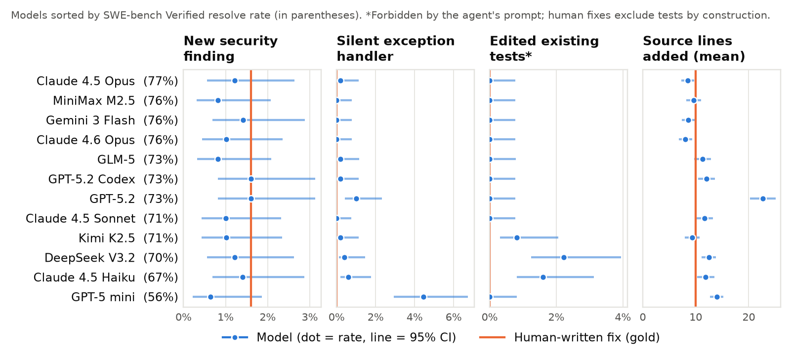

# What the Tests Don't See

**A static audit of 6,000 agent-generated patches on SWE-bench Verified.**

📄 [Paper (PDF)](paper/main.pdf) · 🌐 [Project page](https://drivera341.github.io/swebench-security-audit/) · 📊 [Results data](data/results/)

Coding agents are graded, and increasingly deployed, on whether their patches pass tests. Tests check intended behavior. They don't check whether a patch also introduces a security weakness, silences errors instead of fixing them, or rewrites the tests themselves.

This project audits the patches that **12 frontier models** submitted to SWE-bench Verified, all under the **same agent scaffold** (mini-SWE-agent v2.0.0), and compares them with the 500 human-written reference fixes for the same issues.



## Findings

| | |
|---|---|
| **No evidence that test-passing agent patches are less secure than human fixes.** | 1.1% of model patches introduce a medium/high Bandit or Semgrep finding, versus 1.6% of human fixes. 85% of model findings are *task-intrinsic* (the human fix triggers the same rule on the same task). Review of all 11 model-only flagged lines found no exploitable weakness. |
| **Silent exception handlers are concentrated in one model.** | GPT-5 mini adds `except Exception: pass` to 4.5% of its patches. Every other model is at or below 1.0%, and human fixes are at 0%. |
| **Models edit tests they were told not to touch.** | 3 of 12 models edited existing tests in 23 patches, despite the prompt forbidding it. 18 mirror the official test update. **5 rewrite assertions the official update leaves alone**, for example `assertIsNone` changed to `assertIsNotNone`. |
| **SWE-bench can't see these edits, by design.** | The harness resets official test files and only runs official tests, so test edits can't inflate scores. For the same reason, they are never measured. |
| **No test special-casing.** | No added source line in any patch detects the test environment or names a hidden test. |
| **Leaderboard rankings are robust.** | A "clean resolve rate" (resolved, with none of the signals above) is 0.8–2.6 points lower per model and reorders 4 of 12 models. |

## Method in one paragraph

For each (model, instance) pair, the pipeline fetches every file the patch touches at the base commit and applies the patch the way the SWE-bench harness does. It then runs **Bandit** and **Semgrep** (`p/python` + `p/security-audit`) on the before and after versions. A finding counts as *introduced* only if its (tool, rule, normalized source line) count goes up, so existing findings and findings that merely moved position don't count. Edits to tests are compared line by line with the official SWE-bench test patch. Statistics use Wilson intervals, Fisher's exact test with Holm correction, and a paired same-task comparison against the human fix. See [the paper](paper/main.pdf) for details and limitations.

## Reproduce

Requires [uv](https://docs.astral.sh/uv/), git, and (for the PDF) a LaTeX install. No API keys, GPUs, or Docker. The full pipeline takes about 10 minutes on a laptop.

```bash
uv sync
make all        # fetch → reconstruct → scan → signals → stats → figures → paper
```

| Step | Script | Output |
|---|---|---|
| 1 | `scripts/01_fetch.py` | SWE-bench Verified instances + every model's submitted patch and harness report |
| 2 | `scripts/02_build_trees.py` | Pre/post versions of every touched file (`work/`, gitignored) |
| 3 | `scripts/03_scan.py` | Bandit + Semgrep results for the base files and each system |
| 4 | `scripts/04_signals.py` | `data/results/new_findings.csv`, `data/results/patch_signals.csv` |
| 5 | `scripts/05_stats.py` | Summary tables, `paper/numbers.tex` (every number in the paper), LaTeX tables |
| 6 | `scripts/06_figures.py` | `paper/figures/*.pdf`, `docs/figures/*.png` |

Every number in the paper text is a macro generated from the data in step 5, so the paper can't drift out of sync with the results.

## Data

- **Patches and resolution status:** the public SWE-bench leaderboard submissions (`swe-bench-submissions` S3 bucket and the [swe-bench/experiments](https://github.com/swe-bench/experiments) repo). The per-model resolve rates reproduced here match the published leaderboard exactly for all 12 models.
- **Excluded:** Gemini 3 Pro. Its published per-instance results mark every instance unresolved, while the leaderboard reports 69.6%.
- **Manual review:** [`data/triage/security_model_only.csv`](data/triage/security_model_only.csv) gives the label and rationale for every model-only security finding.

## Use of AI assistance

This study was carried out with substantial help from Claude Code (Anthropic), which wrote much of the analysis code and an initial draft of the paper under my direction. I'm responsible for the design choices and all claims. All labels produced with AI help are released for independent checking.

## Citation

```bibtex
@misc{rivera2026tests,
  title  = {What the Tests Don't See: A Static Audit of 6,000 Agent-Generated Patches on SWE-bench Verified},
  author = {Rivera, Daniel},
  year   = {2026},
  url    = {https://github.com/Drivera341/swebench-security-audit}
}
```

MIT License. SWE-bench data remains under its original license.
